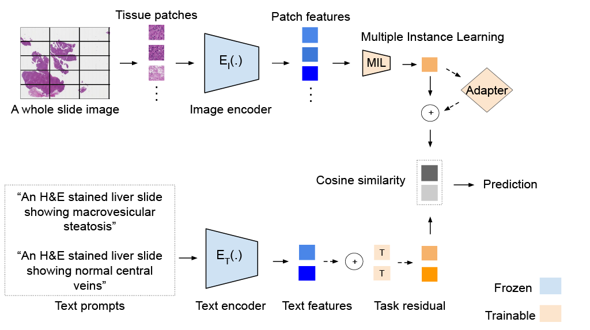

# Predicting Ethanol Drinking Status from Nonhuman Primate Liver Histology: A Proof of Concept for Parameter-efficient Fine-tuning in Few-Shot Vision-Language Modeling

<p align="center">
  
</p>

Amirmohammad Mohammadi, Rupak Khadka, Kathleen A. Grant, Mary Lauren Benton, and Joshua Peeples


Few-shot classification of drinking status from rhesus macaque liver whole-slide
images in the Monkey Alcohol Tissue Research Resource (MATRR). The pipeline uses
frozen CONCH image and text encoders, multiple instance learning (MIL), and
optional visual adapters or text residuals.

## Installation

```bash
pip install -r requirements.txt
```

CONCH weights are required at `models/CONCH/pytorch_model.bin`. A CUDA-capable GPU
is recommended for whole-slide feature extraction. `environment.yml` records the
Conda environment used for development.

## Project structure

```text
demo.py                         # Feature extraction, training, and evaluation
utils/                          # Models, losses, data loading, and visualization
dataset/raw_wsis/               # Input .svs whole-slide images
models/CONCH/pytorch_model.bin  # CONCH checkpoint
models/cache_for_HF/            # Hugging Face model and tokenizer cache
outputs/                       # Features, subject splits, and experiment results
```

The subject metadata in `demo.py` specifies the 37-animal cohort. Slide filenames
must include the cohort and subject ID, for example
`Coh7a_10091_Nx_Liver_HE.svs`. Preprocessing selects the left half of each slide,
filters tissue patches, and extracts 512-dimensional CONCH features. Physical
patches are 224 × 224 pixels at level 0; the encoder's supplied transform resizes
them to 448 × 448. Text inputs use CONCH's 128-position tokenization.

## Training

For a 4-shot experiment with an adapter bottleneck of 128 and LSE text pooling:

```bash
python demo.py --model abmil_adapter --reduction 4 --text_pool lse \
    --shots 4 --iterations 10 --seeds 3 --epochs 250 --lr 1e-3 --patience 50
```

Use `--reduction 64` for an adapter bottleneck of 8. The MIL attention dimension
is controlled separately by `--abmil_d` and defaults to 64. Model choices include
Max Pool (`max_pool`), ABMIL (`zsmil`), ABMIL Adapter (`abmil_adapter`), and
TaskRes (`taskres`). Text prompts support mean and log-sum-exp (`lse`) pooling.

## Evaluation and outputs

Each split assigns distinct animals to training, validation, and testing, with
the requested number of animals per class in both training and validation.
For this cohort, 2-shot uses 4 training, 4 validation, and 29 test animals;
4-shot uses 8 training, 8 validation, and 21 test animals. The same saved splits
are used for all methods. Early stopping selects the lowest validation loss.

New experiments default to `outputs/experiments/`; `--results_root` selects
another directory. Classification results are stored under `raw/`.
Each experiment records its settings,
source hashes, metrics, predictions, checkpoints, learning curves, and ROC curves.
Attention-based models also produce whole-slide visualizations unless
`--skip_xai` is specified.

Feature caches are stored in `outputs/features_conch_v2/` with extraction
metadata. Saved subject splits are reused across methods. Configuration checks
prevent incompatible experiments from overwriting existing results.

Reported metrics are balanced accuracy, ROC AUC, and F1 score. Summary files
contain the mean and standard deviation across splits and seeds. Attention maps
show the weight assigned to each tissue patch during slide classification.

## License

This source code is licensed under the license found in the [`LICENSE`](LICENSE) file in the root directory of this source tree.

This product is Copyright (c) 2026 A. Mohammadi, R. Khadka, K. A. Grant, M. L. Benton, and J. Peeples. All rights reserved.

## Citation

If you use this work, please cite:

### arXiv preprint

```bibtex
@article{mohammadi2026predicting,
  title={Predicting Ethanol Drinking Status from Nonhuman Primate Liver Histology: A Proof of Concept for Parameter-efficient Fine-tuning in Few-Shot Vision-Language Modeling},
  author={Mohammadi, Amirmohammad and Khadka, Rupak and Grant, Kathleen A. and Benton, Mary Lauren and Peeples, Joshua},
  journal={arXiv preprint arXiv:XXXX.XXXXX},
  year={2026}
}
```

